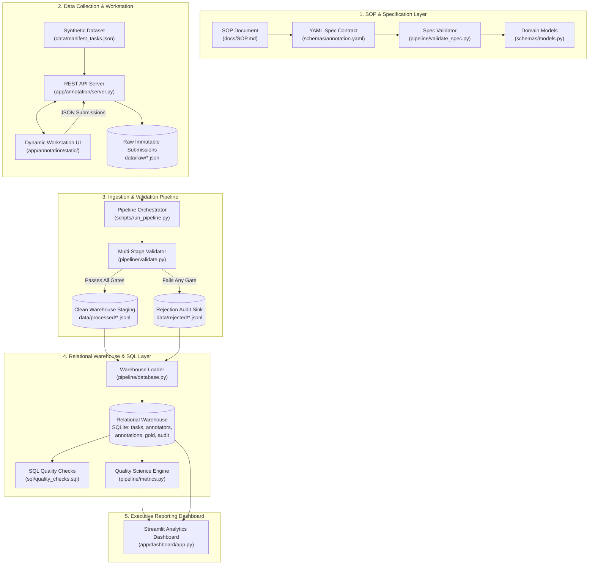

# ANNOTATIONOPS
### SOP-to-Annotation Pipeline & Quality Analytics Dashboard

[](https://github.com/manip/ANNOTATIONOPS/actions/workflows/ci.yml)
[](https://www.python.org/)
[](https://opensource.org/licenses/MIT)
[](https://pydantic.dev)
[](tests/)

---

## 1. Project Overview

**AnnotationOps** is an end-to-end data operations and quality engineering system designed to model a real-world enterprise **Science Annotation Operations** environment. It demonstrates how human operational guidelines (SOPs) are converted into machine-enforceable contracts, audited through multi-tier validation gates, ingested into a relational analytics warehouse, and evaluated through statistical quality science metrics (Cohen's Kappa, confusion matrices, and throughput cycle times).

Targeted specifically at **Science Annotation Operations Analyst** and **Annotation Operations Lead** roles, this project replaces ad-hoc spreadsheet tracking with an automated, auditable, and reproducible operational pipeline.

> [!NOTE]
> **Dataset Transparency Notice:**
> All product image assets and annotation records in this demonstration repository were deterministically generated using Python (`Pillow`, random seed `42`) to provide a self-contained, reproducible, and copyright-free portfolio evaluation. The system is completely **dataset-agnostic** and can ingest any external directory of real product imagery without pipeline modifications (see [docs/DATASET.md](docs/DATASET.md)).

---

## 2. Business Problem & Scenario

In e-commerce reverse logistics and vision-inspection AI, customer returns must be accurately graded into one of three primary conditions:
- **`NEW`**: Unopened merchandise with pristine retail packaging and 100% intact manufacturer seals.
- **`OPEN_BOX`**: Undamaged physical item, but factory seal is broken or packaging has been unsealed.
- **`DAMAGED`**: Visible structural carton puncture, corner crushing, liquid saturation, or product fracture.

### The Operational Challenge
Unstructured guidelines lead to three critical failure modes in annotation operations:
1. **Subjective Guidelines**: Annotators confuse minor cosmetic handling marks with structural damage, causing low Inter-Annotator Agreement (IAA).
2. **Missing Validation Gates**: Incomplete conditional fields (e.g. marking an item `DAMAGED` without recording damage type or description) slip into clean datasets, corrupting ML training sets.
3. **Siloed Analytics**: Operations teams measure only throughput, while science teams measure only model accuracy, leaving guideline ambiguity and annotator fatigue undetected.

---

## 3. System Architecture & Workflow



---

## 4. Technology Stack

- **Data Engineering & Pipeline**: Python 3.13, Pandas 2.2, Pydantic 2.13, PyYAML 6.0
- **Relational Warehouse & SQL**: SQLite (PostgreSQL-compatible DDL), Indexed Schemas, Stored Analytical SQL
- **Quality Science & Agreement**: Scikit-Learn (Cohen's Kappa, Confusion Matrices), SciPy, NumPy
- **Annotation Workstation Interface**: HTML5, Vanilla CSS3, JavaScript (ES6+), Starlette, Uvicorn
- **Executive Analytics Dashboard**: Streamlit 1.32+, Plotly Express, Dark Glassmorphism CSS
- **Testing & Quality Assurance**: pytest 8.x, pytest-cov, Starlette TestClient, Ingestion Ledgers
- **CI/CD & Containerization**: GitHub Actions Matrix (Ubuntu + Windows), Docker, Dockerfile

---

## 5. Standard Operating Procedure (SOP) & Conditional Logic Contract

The operational guidelines ([docs/SOP.md](docs/SOP.md)) establish a strict decision hierarchy:
$$\text{DAMAGED (Priority 1)} \longrightarrow \text{OPEN\_BOX (Priority 2)} \longrightarrow \text{NEW (Priority 3)}$$

### Conditional Logic Enforcement Matrix
| Primary Condition | `packaging_condition` | `seal_condition` | `damage_type` | `damage_severity` | `description` |
| :--- | :--- | :--- | :--- | :--- | :--- |
| **`NEW`** | ❌ FORBIDDEN | ❌ FORBIDDEN | ❌ FORBIDDEN | ❌ FORBIDDEN | ❌ FORBIDDEN |
| **`OPEN_BOX`** | ✅ **REQUIRED** | ✅ **REQUIRED** | ❌ FORBIDDEN | ❌ FORBIDDEN | ❌ FORBIDDEN |
| **`DAMAGED`** | ❌ FORBIDDEN | ❌ FORBIDDEN | ✅ **REQUIRED** | ✅ **REQUIRED** | ✅ **REQUIRED** ($\ge 10$ chars) |

Violations of this matrix are blocked at ingestion with machine-readable rejection reason codes (`ERR_CONDITIONAL_FIELD_MISSING`, `ERR_UNEXPECTED_FIELD_PRESENT`).

---

## 6. Multi-Stage Automated Validation Pipeline

Submissions pass through 4 automated gates in `pipeline/validate.py`:
1. **Stage 1 (Structural Schema)**: Non-empty task ID, annotator ID, valid ISO-8601 UTC timestamp.
2. **Stage 2 (Categorical Integrity)**: Primary label and secondary attributes match declared controlled vocabulary enums.
3. **Stage 3 (Conditional Business Rules)**: Enforces required vs. forbidden secondary fields and checks minimum description length.
4. **Stage 4 (Operational Integrity & Anomalies)**:
   - Rejects physically impossible cycle times ($< 0.5\text{s}$ or $> 1800\text{s}$) with `ERR_IMPOSSIBLE_TIME`.
   - Flags suspicious speed anomalies ($< 2.0\text{s}$) with `WARN_SPEED_ANOMALY_FAST` for supervisor quality review without discarding the record.
   - Detects and rejects duplicate attempts with `ERR_DUPLICATE_SUBMISSION`.

---

## 7. Quality Science & Operational Metrics

The analytical engine (`pipeline/metrics.py`) computes:

### Quality Science Metrics
- **Gold Benchmark Accuracy**: $\ge 95.0\%$ target consensus against blinded expert benchmarks.
- **Cohen's Kappa ($\kappa$)**: Chance-corrected inter-rater agreement:
  $$\kappa = \frac{P_o - P_e}{1 - P_e} \quad (\text{Target } \ge 0.85)$$
- **Confusion Matrix & Precision / Recall**: Pinpoints systematic category confusions.
- **Error Stratification by Difficulty**: Performance across `EASY`, `MEDIUM`, and `HARD` task tiers.

### Operational KPIs
- **Throughput & Velocity**: Completed volume, pending backlog, and completion rate %.
- **Cycle Time Analysis**: Mean, median, minimum, and maximum processing duration per task.
- **Pipeline Rejection Rate**: Ratio of rejected submissions to total attempts (Target $< 5.0\%$).

---

## 8. Relational Database Schema & SQL Layer

Stored in `data/annotationops.db` and queried via documented SQL scripts in `sql/`:
- `tasks`: Catalog of operational units with category and SKU.
- `annotators`: Auditor roster with roles and active status.
- `annotations`: Clean, verified records with `UNIQUE(task_id, annotator_id)`.
- `gold_annotations`: Blinded ground-truth benchmark set.
- `rejection_audit`: Audit trail capturing error codes, failure stages, and raw payloads.

### Key Analytical SQL Scripts
- [`sql/quality_checks.sql`](sql/quality_checks.sql): Verifies zero duplicates, zero null identifiers, and zero conditional violations.
- [`sql/operational_metrics.sql`](sql/operational_metrics.sql): Computes throughput, backlog, and cycle time statistics.
- [`sql/annotator_metrics.sql`](sql/annotator_metrics.sql): Evaluates auditor productivity, rejection rate, and gold accuracy.

---

## 9. Streamlit Executive Dashboard

The interactive multi-page dashboard (`app/dashboard/app.py`) provides:
- **Page 1: Operations Overview**: Real-time queue completion rates, pending backlog, cycle times, and category breakdown.
- **Page 2: Quality Science & Agreement**: Gold-set accuracy, Cohen's Kappa, confusion matrix heatmap, and accuracy by difficulty.
- **Page 3: Annotator Performance**: Workforce leaderboard, cycle time scatter plots, and individual quality tiers.
- **Page 4: Data Quality & Rejections**: Upstream gate failure distribution, error code Pareto chart, and live rejection audit log.
- **Page 5: Operational & Quality Trends**: Longitudinal volume tracking, cycle time stability, and day-over-day accuracy trends.

Every analytical view features **Diagnostic Narrative Callouts** structured around:
- 🔍 **WHAT HAPPENED?**
- 💡 **WHY IT MATTERS?**
- 🎯 **WHERE IS THE ISSUE?**
- 🛠️ **RECOMMENDED INVESTIGATION**

---

## 10. Automated Testing & Idempotency Guarantee

The test suite contains **44 automated tests** with 100% pass rate:
- **Specification Tests (`test_spec_validation.py`)**: 11 unit tests.
- **Domain Model Tests (`test_models.py`)**: 10 unit tests.
- **Dataset Tests (`test_dataset_generation.py`)**: 4 unit tests.
- **Metrics Tests (`test_metrics.py`)**: 6 unit tests.
- **Dashboard Tests (`test_dashboard.py`)**: 3 smoke tests.
- **Workstation API Tests (`test_workstation_api.py`)**: 8 integration tests.
- **Pipeline Integration Tests (`test_pipeline.py`)**: 2 end-to-end tests.

### Idempotency Standard
The pipeline uses an **ingestion ledger** (`data/processed/.ingested_files.json`) and database unique constraints. Running the pipeline multiple times processes newly arrived records only, preventing duplicate database records or distorted analytics.

---

## 11. Quickstart & How to Run Locally

### Prerequisites
- Python 3.11, 3.12, or 3.13
- Git

### 1. Clone & Set Up Environment
```bash
git clone https://github.com/manip/ANNOTATIONOPS.git
cd ANNOTATIONOPS

# Create and activate virtual environment
python -m venv .venv
# On Windows:
.venv\Scripts\activate
# On Linux/macOS:
source .venv/bin/activate

# Install dependencies
pip install -r requirements.txt
```

### 2. Run Automated Tests
```bash
pytest -v
```

### 3. Generate Baseline Dataset & Run Pipeline
```bash
# 1. Generate synthetic product images and gold standard benchmarks (seed=42)
python scripts/generate_dataset.py --num-tasks 120 --seed 42

# 2. Simulate multi-annotator operational submissions with edge cases
python scripts/simulate_annotations.py --count 110 --seed 42

# 3. Execute validation, loading, SQL integrity checks, and metrics computation
python scripts/run_pipeline.py
```

### 4. Launch the Interactive Dashboard
```bash
streamlit run app/dashboard/app.py
```
Open [http://localhost:8501](http://localhost:8501) in your browser.

### 5. (Optional) Launch the Human Annotation Workstation
```bash
python app/annotation/server.py --port 8000
```
Open [http://localhost:8000](http://localhost:8000) to inspect images, grade conditions, and submit annotations in real time.

---

## 12. Docker Deployment

AnnotationOps can be built and run as a standalone Docker container:

```bash
# Build Docker image
docker build -t annotationops:latest .

# Run container exposing dashboard on port 8501
docker run -p 8501:8501 -p 8000:8000 annotationops:latest
```

Navigate to [http://localhost:8501](http://localhost:8501) for the Streamlit dashboard.

---

## 13. Documentation Index

- [docs/SOP.md](docs/SOP.md) - Standard Operating Procedure for Returned Product Condition Classification
- [docs/ARCHITECTURE.md](docs/ARCHITECTURE.md) - Complete Technical Architecture & System Design Document
- [docs/DATA_DICTIONARY.md](docs/DATA_DICTIONARY.md) - Comprehensive Field Definitions, Enums & Rejection Codes
- [docs/DATASET.md](docs/DATASET.md) - Synthetic Dataset Design, Seed Control, and Real-World Substitution Guide
- [docs/TESTING.md](docs/TESTING.md) - Automated Testing Protocol & QA Verification Standards

---

## 14. Implemented vs. Planned Enhancements

### Implemented Functionality (Production Ready)
- [x] Standard Operating Procedure with hierarchical decision rules.
- [x] Structured YAML specification contract and automated spec validator.
- [x] Pydantic domain models enforcing conditional business logic.
- [x] Deterministic synthetic dataset generator with seed control (`seed=42`).
- [x] Blinded gold-standard benchmark set with difficulty stratification.
- [x] Human annotation workstation with dynamic conditional fields and pacing timer.
- [x] Multi-stage ingestion, validation, and rejection audit pipeline.
- [x] Relational warehouse (SQLite) with indexed tables and foreign keys.
- [x] Automated SQL data quality integrity checks asserting zero violations.
- [x] Quality science engine computing Cohen's Kappa, confusion matrices, and throughput KPIs.
- [x] 5-page Streamlit analytics dashboard with narrative diagnostic callouts.
- [x] Idempotent execution and historical backfill script.
- [x] 44 automated pytest unit and integration tests passing with 100% success.
- [x] GitHub Actions CI workflow running multi-OS matrix tests.
- [x] Production Dockerfile and complete technical documentation.

### Planned Enhancements (Future Scope)
- [ ] Active Learning queue re-ranking to prioritize high-uncertainty returned items.
- [ ] Multi-tenant role-based access control (RBAC) with OAuth2 / SSO integration.
- [ ] Optional cloud event-driven ingestion using AWS S3 upload events and AWS Lambda validation workers.
