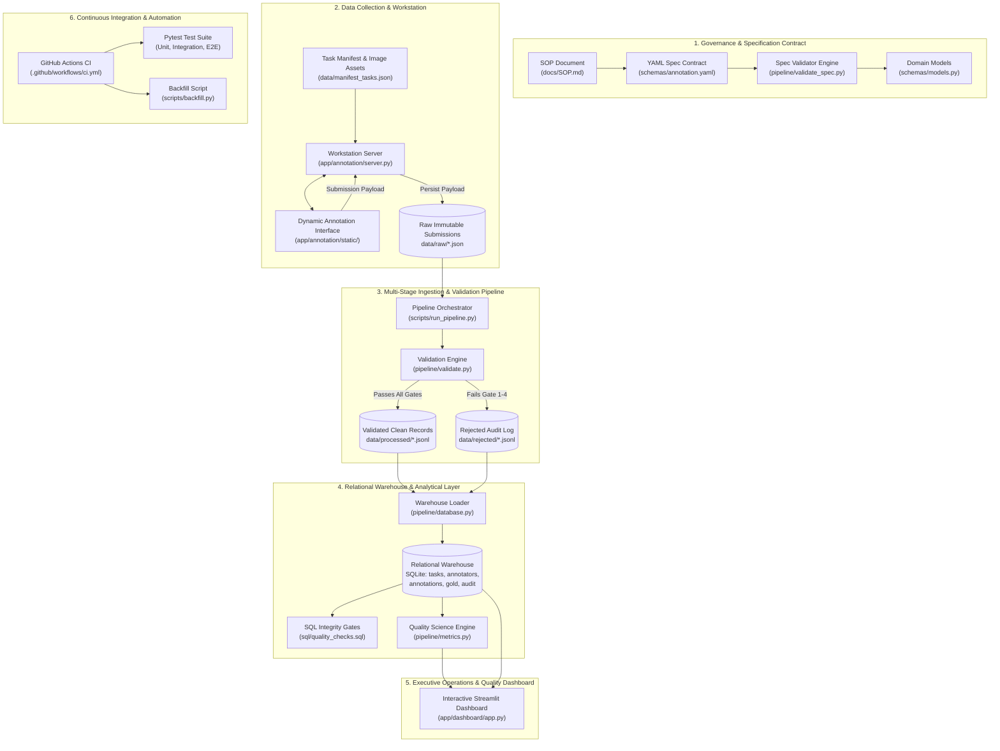

# System Architecture & Technical Design Document

**Project:** ANNOTATIONOPS  
**Subsystem:** SOP-to-Annotation Pipeline & Quality Analytics Dashboard  
**Status:** Approved for Production  
**Author:** Science Annotation Operations Engineering Team  

---

## 1. Architectural Overview & Design Philosophy

AnnotationOps is built to bridge the gap between unstructured human operational guidelines and ML training dataset reliability. In real-world data operations, human error, ambiguous SOP phrasing, and silent schema drift are the primary culprits behind degraded model performance. 

The architecture adheres to four core engineering principles:
1. **Contract-First Governance**: Business rules and conditional requirements are expressed in machine-enforceable contracts (`schemas/annotation.yaml`), not hardcoded in UI forms.
2. **Strict Immutability at Ingestion**: Raw submissions are stored as immutable point-in-time JSON artifacts (`data/raw/`) before any transformation occurs.
3. **Fail-Closed Validation Gates**: Invalid records are explicitly rejected with structured reason codes and routed to an audit sink (`data/rejected/`) rather than silently dropped or coerced.
4. **Idempotent Data Engineering**: Ingestion and warehousing scripts can be executed repeatedly with zero record duplication or analytical corruption.

---

## 2. End-to-End System Architecture

---

## 3. Subsystem Breakdown

### 3.1 Specification & Governance Layer
- **Input**: Human operational definitions from `docs/SOP.md`.
- **Output**: Formalized machine contract in `schemas/annotation.yaml`.
- **Verification**: `pipeline/validate_spec.py` enforces root key presence, unique condition labels, enum allowed value consistency, broken reference detection (conditional rules referring to undeclared fields), and mutual exclusion constraints (a field cannot be both required and forbidden in the same condition).

### 3.2 Collection & Workstation Interface
- **Frontend**: Clean vanilla HTML5, CSS3, and JavaScript workstation (`app/annotation/static/`).
- **Dynamic Conditional Rendering**:
  - Selecting `NEW` automatically hides and clears secondary inputs.
  - Selecting `OPEN_BOX` mounts mandatory `packaging_condition` and `seal_condition` dropdowns.
  - Selecting `DAMAGED` mounts mandatory `damage_type`, `damage_severity`, and a factual `description` field with a minimum 10-character counter.
- **Backend**: Starlette and Uvicorn REST server (`app/annotation/server.py`) serving API routes:
  - `GET /api/tasks`: Pulls active task backlog.
  - `GET /api/images/{filename}`: Securely serves product inspection imagery.
  - `POST /api/annotate`: Validates client payloads against Pydantic models before committing them to the immutable raw staging sink (`data/raw/`).

### 3.3 Multi-Stage Ingestion & Validation Engine
The ingestion engine (`pipeline/validate.py`) executes 4 sequential validation gates:
1. **Stage 1 (Structural Schema)**: Asserts non-empty `task_id`, `annotator_id`, `annotation_timestamp`.
2. **Stage 2 (Categorical Integrity)**: Verifies that condition is within `[NEW, OPEN_BOX, DAMAGED]` and enum values conform to declared allowed sets.
3. **Stage 3 (Conditional Business Logic)**: Validates against `schemas/models.py`:
   - Rejects with `ERR_UNEXPECTED_FIELD_PRESENT` if secondary attributes appear on `NEW`.
   - Rejects with `ERR_CONDITIONAL_FIELD_MISSING` if secondary attributes are absent on `OPEN_BOX` or `DAMAGED`.
   - Rejects with `ERR_DESCRIPTION_TOO_SHORT` if damage description has $< 10$ characters.
4. **Stage 4 (Operational Integrity & Anomalies)**:
   - Rejects with `ERR_IMPOSSIBLE_TIME` if duration $< 0.5\text{s}$ or $> 1800\text{s}$.
   - Flags with `WARN_SPEED_ANOMALY_FAST` if duration $< 2.0\text{s}$ for supervisor audit review without discarding the record.
   - Detects and rejects duplicate submissions (`ERR_DUPLICATE_SUBMISSION`).

### 3.4 Relational Warehouse Layer (SQLite / PostgreSQL-Ready)
The database layer (`pipeline/database.py`) maintains 5 relational tables:
- `tasks`: Task catalog with SKU, product category, and synthetic markers.
- `annotators`: Workforce metadata (ID, display name, operational role).
- `annotations`: Clean, verified submissions with composite unique constraint `UNIQUE(task_id, annotator_id)`.
- `gold_annotations`: Ground-truth benchmark items with verified condition and difficulty ratings.
- `rejection_audit`: Rejection records capturing error code, failure stage, and raw payload string for auditability.

Indexes are created on `task_id`, `annotator_id`, `annotation_timestamp`, and `rejection_code` to ensure constant-time joins during analytical dashboard queries.

### 3.5 Quality Science Engine
`pipeline/metrics.py` implements mathematical algorithms for quality measurement:
- **Cohen's Kappa ($\kappa$)**:
  $$\kappa = \frac{P_o - P_e}{1 - P_e}$$
  Quantifies inter-rater agreement and annotator agreement against the gold benchmark adjusted for chance agreement.
- **Confusion Matrix & Precision / Recall**:
  Constructs a multi-class contingency matrix comparing annotated conditions against verified ground truth, isolating systematic misclassifications.
- **Throughput & Operational KPIs**:
  Calculates completion rate, pending backlog, average and median cycle time, and overall pipeline rejection rates.

### 3.6 Streamlit Quality & Operations Dashboard
`app/dashboard/app.py` delivers an executive-grade 5-page analytics suite:
- **Page 1: Operations Overview**: Queue progress, completion rate, pending backlog, and category breakdown.
- **Page 2: Quality Science**: Gold accuracy, Cohen's Kappa, confusion matrix, and accuracy by task difficulty.
- **Page 3: Annotator Performance**: Leaderboard, productivity vs. pacing scatter, and individual accuracy rankings.
- **Page 4: Data Quality & Rejections**: Failure reasons, validation stage distribution, and live rejection audit log.
- **Page 5: Operational & Quality Trends**: Daily throughput line charts, cycle time stability, and day-over-day accuracy tracking.

---

## 4. Idempotency & Fault-Tolerance Strategy

Idempotency is guaranteed through a dual-mechanism approach:
1. **Ingestion Ledger (`data/processed/.ingested_files.json`)**:
   Tracks the processing status of every file in `data/raw/`. On rerun, previously processed files are identified and bypassed in $\mathcal{O}(1)$ time.
2. **Warehouse Deduplication**:
   - `annotations` enforces `UNIQUE(task_id, annotator_id)` via `INSERT OR IGNORE`.
   - `rejection_audit` enforces `UNIQUE(task_id, annotator_id, rejection_code, rejected_at)` via `INSERT OR IGNORE`.
3. **Automated Reprocessing (`scripts/backfill.py`)**:
   Enables deterministic rebuilds from raw immutable sources upon demand.
