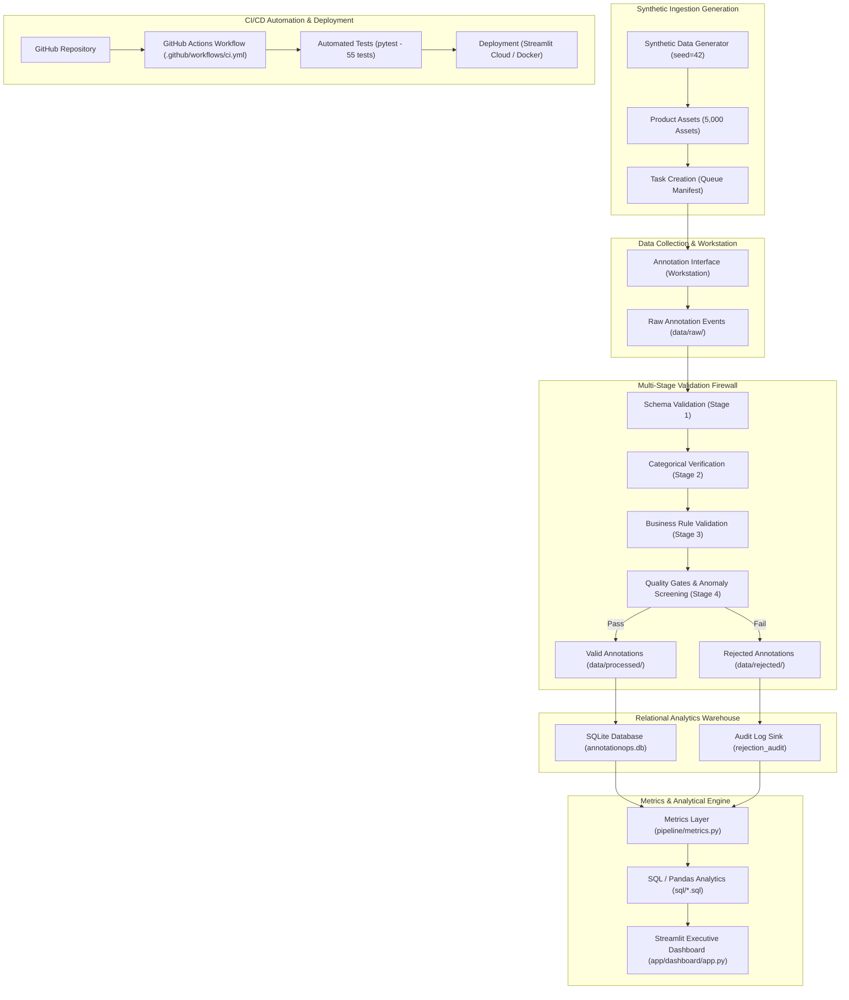

# System Architecture & Technical Design Document (v2 Enterprise)

**Project:** ANNOTATIONOPS  
**Subsystem:** Enterprise SOP-to-Annotation Operations, Data Quality Firewall & Analytics Warehouse  
**Status:** Approved for Production  
**Scope:** Architecture, Data Lineage, CI/CD Automation, and Deployment  

---

## 1. Architectural Overview & Design Philosophy

AnnotationOps bridges the gap between human operational Standard Operating Procedures (SOPs) and high-reliability ML training dataset infrastructure. In real-world enterprise operations, human rater variance, ambiguous guideline phrasing, and silent schema drift are the primary failure modes.

The architecture adheres to five core engineering principles:
1. **Contract-First Governance**: Business rules and conditional requirements are expressed in a declarative machine-enforceable contract (`schemas/annotation.yaml`), not hardcoded into UI code.
2. **Strict Immutability at Ingestion**: Raw submissions are stored as immutable point-in-time JSON payloads (`data/raw/`) before any ingestion processing.
3. **Fail-Closed Validation Firewall**: Invalid records are explicitly rejected with structured reason codes and routed to an audit sink (`data/rejected/`) rather than silently coerced.
4. **Idempotent Data Engineering**: Ingestion and warehousing scripts can be executed repeatedly with zero record duplication or analytical corruption.
5. **Reconciliation & Auditability**: Every KPI presented on the dashboard reconciles mathematically back through SQL to the underlying raw submissions.

---

## 2. End-to-End System Architecture Diagram



---

## 3. Pipeline Processing Flow & Validation Gates

The data pipeline strictly processes data across 4 sequential stages:

```
RAW SUBMISSION
      ↓
[STAGE 1: SCHEMA VALIDATION]
Checks non-empty task_id, annotator_id, ISO-8601 timestamp, JSON syntax, duplicate (task, annotator) check.
      ↓
[STAGE 2: CATEGORICAL VERIFICATION]
Validates primary condition in controlled vocabulary ['NEW', 'OPEN_BOX', 'DAMAGED'].
      ↓
[STAGE 3: SOP BUSINESS RULE VALIDATION]
Enforces conditional logic:
- If NEW: all secondary fields must be null (forbidden).
- If OPEN_BOX: packaging_condition and seal_condition are mandatory; damage fields forbidden.
- If DAMAGED: damage_type, damage_severity, description (>=10 chars) mandatory; open box fields forbidden.
      ↓
[STAGE 4: OPERATIONAL INTEGRITY & ANOMALY SCREENING]
Validates processing_time_seconds within physical bounds [0.5s, 1800.0s].
Flags speed anomalies (<3.0s) for supervisor audit.
      ↙       ↘
   VALID      REJECTED
     ↓           ↓
clean_annotations.jsonl   rejected_annotations.jsonl
     ↓           ↓
SQLite Warehouse      Rejection Audit Table
```

---

## 4. Relational Warehouse Architecture

SQLite is configured as the analytical warehouse engine. At 25,000 records, indexed SQLite executes all 25 operational queries in under 50ms.

### Relational Schema Entity-Relationship
- **`tasks`**: 5,000 catalog assets (`task_id`, `image_id`, `image_path`, `product_category`, `category_group`, `sku`, `difficulty`, `priority`, `status`, `synthetic`, `created_at`).
- **`annotators`**: 12 workforce personas (`annotator_id`, `display_name`, `role`, `team`, `shift`, `experience_level`, `active`).
- **`gold_annotations`**: 400 ground-truth verification benchmarks (`task_id`, `ground_truth_condition`, secondary ground truth, `difficulty`, `verified_by`).
- **`annotations`**: 24,983 validated clean events (`annotation_id`, `task_id`, `annotator_id`, `condition`, secondary fields, timestamps, durations, `is_rework`, `is_escalated`).
- **`rejection_audit`**: 893 intercepted violations (`rejection_id`, `task_id`, `annotator_id`, `rejection_code`, `rejection_reason`, `validation_stage`, `raw_payload`, `rejected_at`).
- **`operational_events`**: 4 milestone events across 12-week operational timeline.
- **`simulation_targets`**: 5 project SLA baseline thresholds.

---

## 5. Automated CI/CD & Deployment Pipeline

The continuous integration pipeline is defined in `.github/workflows/ci.yml`:
1. **Environment Setup**: Python 3.11 / 3.12 / 3.13 matrix runner.
2. **Lint & Code Style**: Fast static inspection via `ruff`.
3. **Specification Verification**: `python pipeline/validate_spec.py` tests YAML syntax and graph consistency.
4. **Deterministic Generation**: Generates 5,000 assets and tests bitwise deterministic reproducibility under `seed=42`.
5. **Validation Pipeline**: Ingestion firewall runs end-to-end against raw payloads.
6. **Warehouse & SQL Gates**: Executes and asserts all 25 analytical SQL queries.
7. **Complete Automated Test Suite**: Executes 55 automated unit, integration, reconciliation, SLA variance, and performance benchmark tests.
8. **Deployment Target**:
   - Streamlit Community Cloud: configured via `.streamlit/config.toml`.
   - Production Docker container: multi-stage build via `Dockerfile`.
