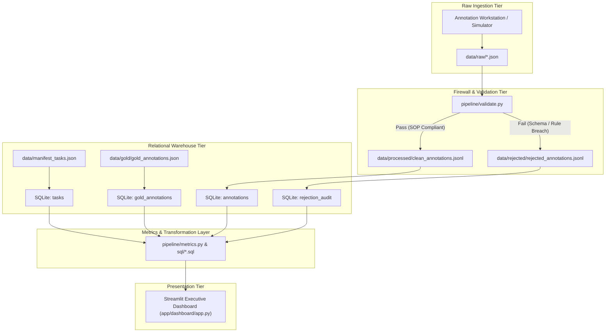

# Data Dictionary & Schema Reference (v2 Enterprise)

**System:** ANNOTATIONOPS  
**Scope:** Raw Payloads, Warehouse Relational Tables, Data Quality Audit Sinks, Gold Benchmarks, and Data Lineage  
**Version:** 2.0.0 (Enterprise Synthetic Scale)  

> [!NOTE]
> **Dataset Disclosure:** All tables contain enterprise-scale synthetic data generated deterministically (`seed = 42`) for portfolio demonstration. Annotator personas, operational event milestones, and SLA targets are simulated.

---

## 1. Clean Annotations (`annotations` table & `clean_annotations.jsonl`)

Represents validated, audit-passed human annotation records loaded into the analytics warehouse.

| Field Name | Storage Type | Nullable? | Constraints / Allowed Values | Description & Analytical Purpose |
| :--- | :--- | :--- | :--- | :--- |
| `annotation_id` | `TEXT` (UUID) | No | Primary Key | Globally unique identifier for the verified submission record. |
| `task_id` | `TEXT` | No | Foreign Key -> `tasks(task_id)` | Identifier of the evaluated product asset. |
| `image_id` | `TEXT` | No | Valid image file name | Reference to visual photographic inspection asset. |
| `annotator_id` | `TEXT` | No | Foreign Key -> `annotators(annotator_id)` | Unique identifier of the simulated auditor who classified the item. |
| `condition` | `TEXT` (Enum) | No | `NEW`, `OPEN_BOX`, `DAMAGED` | Primary triage classification governed by SOP decision hierarchy. |
| `packaging_condition` | `TEXT` (Enum) | Yes | `INTACT`, `WORN`, `MISSING` | Physical integrity of retail packaging. **Required for `OPEN_BOX`**, forbidden otherwise. |
| `seal_condition` | `TEXT` (Enum) | Yes | `BROKEN`, `MISSING`, `RESEALED` | State of tamper-evident sticker. **Required for `OPEN_BOX`**, forbidden otherwise. |
| `damage_type` | `TEXT` (Enum) | Yes | `CRUSHED_BOX`, `TEAR_PUNCTURE`, `LIQUID_STAIN`, `ITEM_DEFECT` | Structural failure mechanism. **Required for `DAMAGED`**, forbidden otherwise. |
| `damage_severity` | `TEXT` (Enum) | Yes | `MINOR`, `MODERATE`, `SEVERE` | Magnitude of damage. **Required for `DAMAGED`**, forbidden otherwise. |
| `description` | `TEXT` | Yes | 10 to 250 characters | Factual visual defect description. **Required for `DAMAGED`**, forbidden otherwise. |
| `annotation_timestamp` | `TIMESTAMP` | No | ISO-8601 UTC string | Precise timestamp when annotation was completed. Used for time-series throughput. |
| `processing_time_seconds`| `REAL` | No | $0.5 \le t \le 1800.0$ | Active seconds spent on task. Used for cycle time and fatigue tracking. |
| `anomaly_flag` | `TEXT` | Yes | `WARN_SPEED_ANOMALY_FAST`, `null` | Operational review tag if submission completed faster than nominal threshold ($< 3.0\text{s}$). |
| `is_rework` | `INTEGER` | No | `0` or `1` | Flag indicating whether this record represents a secondary rework inspection. |
| `is_escalated` | `INTEGER` | No | `0` or `1` | Flag indicating whether this item was escalated for specialist review. |
| `schema_version` | `TEXT` | No | SemVer (`1.0.0`) | Version of specification contract against which submission was validated. |
| `ingested_at` | `TIMESTAMP` | No | Default `CURRENT_TIMESTAMP` | System ingestion timestamp for warehouse auditability. |

---

## 2. Rejection Audit Log (`rejection_audit` table & `rejected_annotations.jsonl`)

Captures all submissions blocked by automated validation gates with structured root-cause reason codes.

| Field Name | Storage Type | Nullable? | Example Values | Description & Operational Purpose |
| :--- | :--- | :--- | :--- | :--- |
| `rejection_id` | `INTEGER` | No | Auto-increment Primary Key | Unique identifier for the rejection event. |
| `task_id` | `TEXT` | Yes | `AST-00045` | Task ID associated with rejected submission (null if schema unparseable). |
| `annotator_id` | `TEXT` | Yes | `ANNO-02` | Submitting auditor (null if missing in payload). Used for annotator error rate tracking. |
| `rejection_code` | `TEXT` | No | `ERR_CONDITIONAL_FIELD_MISSING` | Standardized machine-readable error code. |
| `rejection_reason` | `TEXT` | No | Human-readable explanation | Detailed error message emitted by Pydantic validation engine. |
| `validation_stage` | `TEXT` | No | `STAGE_1_SCHEMA`, `STAGE_2_CATEGORICAL`, `STAGE_3_CONDITIONAL_RULES`, `STAGE_4_OPERATIONAL` | Pipeline stage where submission was intercepted. |
| `raw_payload` | `TEXT` | No | JSON string | Exact raw payload submitted, preserved for dispute resolution or retraining. |
| `rejected_at` | `TIMESTAMP` | No | ISO-8601 UTC string | Timestamp when rejection was recorded. |

---

## 3. Tasks Catalog Queue (`tasks` table)

| Field Name | Storage Type | Nullable? | Constraints / Examples | Description |
| :--- | :--- | :--- | :--- | :--- |
| `task_id` | `TEXT` | No | Primary Key (`AST-00001` to `AST-05000`) | Unique product asset identifier. |
| `image_id` | `TEXT` | No | `img_00001.png` | Reference to visual image asset. |
| `image_path` | `TEXT` | No | `data/images/img_00001.png` | Storage path on disk. |
| `product_category` | `TEXT` | Yes | 8 Categories (e.g. `Smart Fitness Watch`) | Retail merchandise category. |
| `category_group` | `TEXT` | Yes | `Consumer Tech`, `Household & Appliances` | High-level business category grouping. |
| `sku` | `TEXT` | Yes | `AUDIO-042`, `ELEC-105` | Stock Keeping Unit code. |
| `difficulty` | `TEXT` | No | `EASY`, `MEDIUM`, `HARD` | Stratified task complexity. |
| `priority` | `TEXT` | No | `LOW`, `NORMAL`, `HIGH`, `CRITICAL` | Operational dispatch priority tier. |
| `status` | `TEXT` | No | `COMPLETED`, `PENDING`, `REWORK`, `ESCALATED` | Operational queue status. Reconciles exactly to total tasks. |
| `synthetic` | `INTEGER` | No | `1` | Explicit synthetic data indicator. |
| `created_at` | `TIMESTAMP` | No | Default `CURRENT_TIMESTAMP` | Ingestion timestamp into queue. |

---

## 4. Workforce Roster (`annotators` table)

| Field Name | Storage Type | Nullable? | Example Values | Description |
| :--- | :--- | :--- | :--- | :--- |
| `annotator_id` | `TEXT` | No | Primary Key (`ANNO-01` to `ANNO-12`) | Unique identifier for simulated annotator persona. |
| `display_name` | `TEXT` | No | `Auditor Alpha`, `Lead Specialist` | Display callsign. |
| `role` | `TEXT` | No | `Junior Annotator`, `Standard Annotator`, `Senior Annotator`, `Quality Reviewer`, `Lead Specialist` | Operational role tier. |
| `team` | `TEXT` | No | `Team Alpha`, `Team Beta`, `Quality Team` | Operational team assignment. |
| `shift` | `TEXT` | No | `Morning`, `Evening` | Working shift schedule. |
| `experience_level` | `TEXT` | No | `0-6 months`, `6-18 months`, `2+ years`, `3+ years`, `4+ years` | Auditor seniority baseline. |
| `active` | `INTEGER` | No | `1` | Active operational status flag. |

---

## 5. Gold Standard Benchmarks (`gold_annotations` table)

| Field Name | Storage Type | Nullable? | Description |
| :--- | :--- | :--- | :--- |
| `task_id` | `TEXT` | No | Primary Key -> `tasks(task_id)`. |
| `image_id` | `TEXT` | No | Visual reference asset. |
| `ground_truth_condition` | `TEXT` (Enum) | No | Verified consensus condition label (`NEW`, `OPEN_BOX`, `DAMAGED`). |
| `ground_truth_packaging_condition` | `TEXT` (Enum) | Yes | Verified packaging state. |
| `ground_truth_seal_condition` | `TEXT` (Enum) | Yes | Verified tamper seal state. |
| `ground_truth_damage_type` | `TEXT` (Enum) | Yes | Verified damage mechanism. |
| `ground_truth_damage_severity` | `TEXT` (Enum) | Yes | Verified damage severity tier. |
| `ground_truth_description` | `TEXT` | Yes | Verified expert damage summary. |
| `difficulty` | `TEXT` (Enum) | No | `EASY`, `MEDIUM`, `HARD` stratification. |
| `verified_by` | `TEXT` | No | Benchmarked by Lead Quality Science Specialist. |
| `synthetic` | `INTEGER` | No | Flag (`1` = synthetic benchmark). |

---

## 6. Operational Events (`operational_events` table)

| Field Name | Storage Type | Nullable? | Description |
| :--- | :--- | :--- | :--- |
| `event_id` | `TEXT` | No | Primary Key (`EVT-W05`, `EVT-W07`, `EVT-W09`, `EVT-W10`). |
| `week_number` | `INTEGER` | No | Operational week (1 to 12). |
| `event_type` | `TEXT` | No | `VOLUME_SPIKE`, `QUALITY_DIP`, `PROCESSING_TIME_INCREASE`, `PROCESS_RECOVERY`. |
| `title` | `TEXT` | No | Human-readable scenario title. |
| `description` | `TEXT` | No | Cause and background of scenario. |
| `impact_summary` | `TEXT` | No | Observed metric shift and resolution. |

---

## 7. Simulation Targets (`simulation_targets` table)

| Field Name | Storage Type | Nullable? | Description |
| :--- | :--- | :--- | :--- |
| `metric_key` | `TEXT` | No | Primary Key (e.g. `quality_accuracy_pct`, `rejection_rate_pct`). |
| `metric_name` | `TEXT` | No | Display name. |
| `target_value` | `REAL` | No | Target numerical threshold (e.g. `95.0`, `3.0`, `12.0`). |
| `unit` | `TEXT` | No | `%`, `s`, `score`. |
| `benchmark_type` | `TEXT` | No | `MINIMUM` or `MAXIMUM`. |
| `description` | `TEXT` | No | Operational business purpose. |

---

## 8. End-to-End Data Lineage

Every dashboard KPI is traceable down to its underlying raw JSON payload and relational SQL query.
